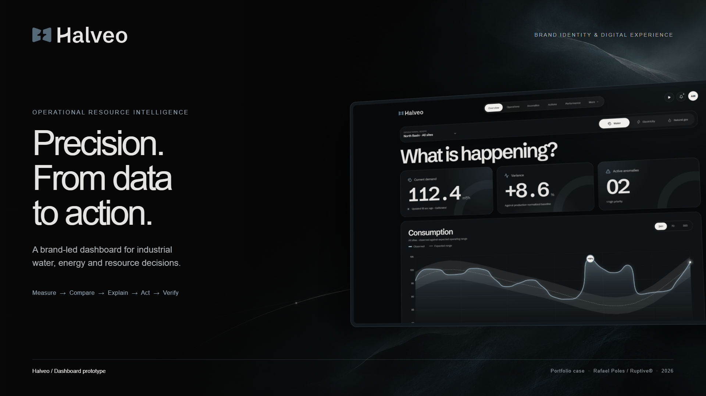
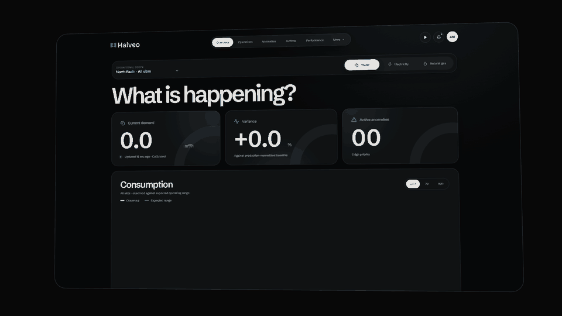
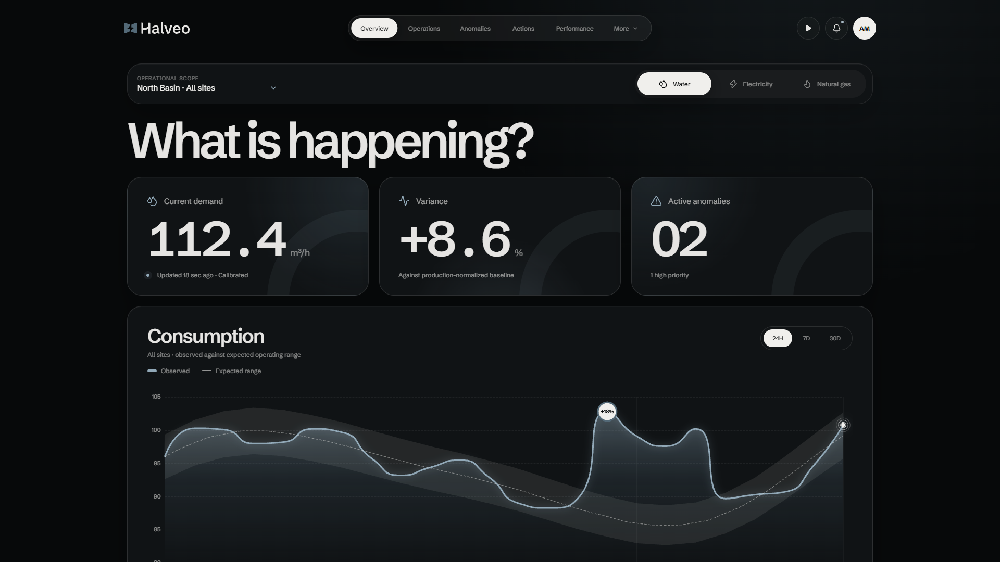
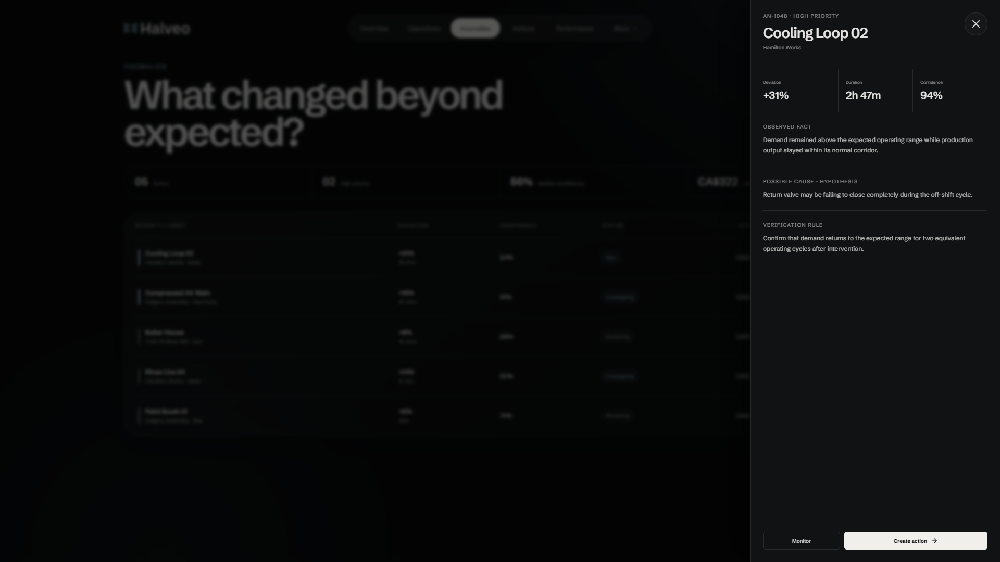
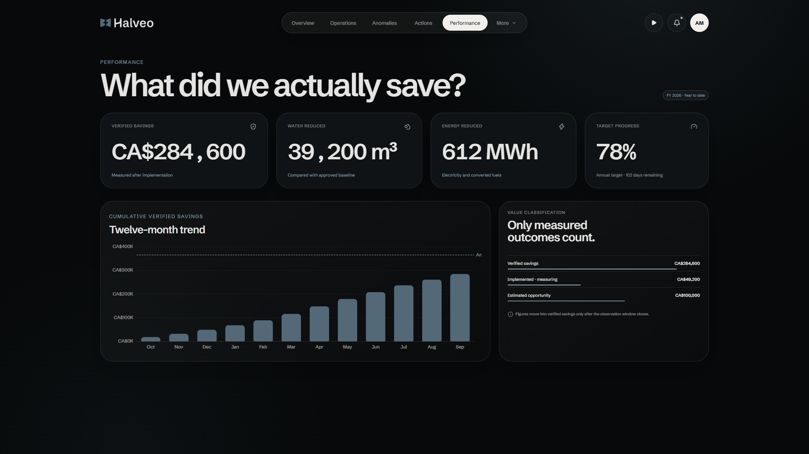

# Halveo Dashboard

**Industrial resource intelligence, from measurement to action.**

A fictional product and brand experience by **Rafael Poles / Ruptive®**. Halveo brings water, electricity and natural gas into one operational workspace, helping teams investigate deviations, coordinate interventions and distinguish estimated opportunities from measured outcomes.

Brand strategy · Visual identity · Product design · Data visualization · Motion · Front-end development

[Português](README.pt-BR.md) · [Product guide](docs/product.md) · [Architecture](docs/architecture.md) · [Demo & gallery](docs/demo.md)

> Portfolio prototype. North Basin Manufacturing, its facilities, people, readings and results are fictional. This is a working front-end demonstration with local fixtures and browser storage.

## From a brand idea to a working product

The wider Halveo case explores the evolution of EcoSense from periodic environmental consulting into recurring operational intelligence. The dashboard translates that positioning into a concrete decision workflow:

**Measure → Compare → Explain → Act → Verify**

The design challenge was to make industrial information useful to operations teams, executives and reporting teams without reducing every decision to a sustainability headline. Readings come with context; hypotheses are labelled; opportunities remain separate from verified savings.

The name suggests reduction. The interface asks for evidence.

## See the experience



[Watch the existing 20-second Full HD motion](docs/media/dashboard-motion.mp4) · [View all screenshots](docs/demo.md)

The GIF is a compact 960 × 540 preview. The MP4 is the existing 1920 × 1080, 60 fps portfolio motion with sound. It is an edited presentation built from interface captures, rather than an uncut screen recording. The gallery below contains fresh captures of the production build.



## What you can explore

| Area | Working interactions and content |
| --- | --- |
| **Overview** | Site and resource filters; 24H / 7D / 30D comparison; demand, variance, anomalies, savings and opportunity mix |
| **Operations** | Demand profile, asset search, empty state, data quality and an expandable baseline explanation |
| **Anomalies** | Severity filtering and an investigation drawer separating observed fact, possible cause and verification rule |
| **Actions** | Create an action from an anomaly; advance it from Proposed to Verified; persist changes locally |
| **Performance** | Demonstration savings, target progress and a twelve-month trend, with separate value classifications |
| **Reports** | Reporting boundary, illustrative disclosure mappings, fixture audit events and a downloadable CSV |
| **Data Sources** | Five example sources, reading cadence, coverage and quality labels |
| **Settings** | Persistent compact density and guided-demo preferences; system motion preference |

Notifications link to relevant views. A five-step guided demo connects detection, explanation, action, verification and reporting.

### A practical path through the prototype

1. Compare water demand in **Overview**, then switch site or resource.
2. Open **Anomalies** and inspect an event's fact, hypothesis and confidence.
3. Select **Create action**. Existing linked actions are reused; new ones are added when needed.
4. Advance an action through review, approval, scheduling, implementation and simulated verification.
5. Review **Performance** and export the sample evidence table in **More → Reports**.

Action status changes are local demonstrations. They do not recalculate the static Performance totals or certify a measured result.

## Design system

The original mark uses two complementary forms to reveal a **lightning bolt in negative space**. The repository retains the original SVG paths for both the mark and wordmark.

| Element | Application |
| --- | --- |
| Carbon — `#0A0A0A` | Primary brand foundation and dark surfaces |
| Slate — `#536977` | Data, emphasis and technical identity |
| Mineral — `#E5E4E2` | Primary typography and contrast |
| Schibsted Grotesk | Interface typography; Google Fonts with a system fallback |
| Editorial hierarchy | Large operational questions, tabular numbers, thin borders and connected chart panels |
| Motion | Navigation continuity, restrained feedback and progressive visual entry |

The app also uses derived dark surfaces and functional status colours. [Design rationale and implementation notes](docs/design-system.md).

| Investigation | Measured-outcome view |
| --- | --- |
|  |  |

## Built with

| Technology | Role |
| --- | --- |
| React 19 + TypeScript 7 | Typed interface, view state and reusable rendering functions |
| Vite 8 | Development server and static production build |
| Apache ECharts 6 | Demand profiles, savings, targets and opportunity visualization |
| Motion | Page, navigation and component transitions |
| GSAP + Anime.js | Opening choreography and brand entrance |
| Three.js | Optional ambient field, skipped on small screens and reduced motion |
| Lucide React + CSS | Icons, design tokens, responsive layouts and interaction states |
| Playwright | Browser smoke checks and reproducible portfolio screenshots |

## Run locally

Use **Node.js 24** and **pnpm 11.25.0**. The pnpm version is recorded in `package.json`; `.nvmrc` specifies Node 24. No environment variables, account or API keys are required.

```sh
pnpm install --frozen-lockfile
pnpm dev
```

Open the local URL printed by Vite (port `4173` by default).

```sh
pnpm build
pnpm preview
```

The production output is `dist/`. Relative asset paths support static hosting under a repository subdirectory. No hosted demo is configured in this delivery.

### Commands

| Command | Purpose |
| --- | --- |
| `pnpm dev` | Start the development server |
| `pnpm check` | Check the app and Vite configuration types without emitting files |
| `pnpm build` | Type-check and build the static app |
| `pnpm preview` | Serve the production build locally |
| `pnpm test:smoke` | Exercise key workflows on the production build |
| `pnpm capture` | Recreate desktop and mobile screenshots in `docs/media/` |
| `pnpm cover` | Rebuild the cover using the retained background, original SVG and real screenshot |

For browser checks or captures, first run `pnpm build` and `pnpm exec playwright install chromium`. If Chromium is already supplied by the system, `PLAYWRIGHT_CHANNEL=chrome` selects Google Chrome; see the PowerShell example in [development](docs/development.md).

## Repository map

| Path | Contents |
| --- | --- |
| `src/App.tsx` | Application shell, views, charts and interactive workflows |
| `src/data.ts` | Typed deterministic fixtures, resources, sites and action states |
| `src/styles.css` | Brand tokens, interface styles and responsive behaviour |
| `src/assets/` | Original SVG identity used by the app |
| `public/` | Static favicon |
| `scripts/` | Browser helpers, workflow checks, screenshots and cover composition |
| `docs/` | Product, architecture, design, development and delivery documentation |
| `docs/media/` | Cover, screenshots, GIF and Full HD MP4 |
| `docs/brand/` | Original identity references and generated cover background |
| `docs/archive/` | Preserved early planning and strategic references, explicitly historical |
| `.github/workflows/` | Type-check, build and browser smoke-check workflow |

## Scope and next steps

This case demonstrates a brand-led product interface. It does **not** include authentication, a backend, real telemetry, industrial connectors, permission enforcement or a compliance engine. Most analytics are illustrative fixtures. Filters affect Overview and Operations; the other views are demonstration-wide. Reporting exports two fixed sample rows.

The main engineering next steps are to split the single application module, reconcile all charts against one domain model, connect a real data layer, add robust persistence and complete keyboard/focus and assistive-technology audits. [Current scope and roadmap](docs/product.md#implementation-boundaries).

The production build and browser workflows were checked locally. The automated workflow is included for GitHub; its remote run and a clean online dependency installation still need to occur after publishing. [Validation and delivery record](docs/delivery.md).

## Credits and rights

**Rafael Poles / Ruptive®** — Halveo brand and portfolio case. The development process used AI assistance for implementation, documentation and the abstract cover background. The cover combines that background with the original vector identity and a real screenshot; it does not generate the interface or redraw the mark.

Third-party packages, typography and motion audio retain their own terms. [Credits](docs/credits.md). This repository does not grant a general reuse licence for the project code or brand assets; see [LICENSE](LICENSE).
