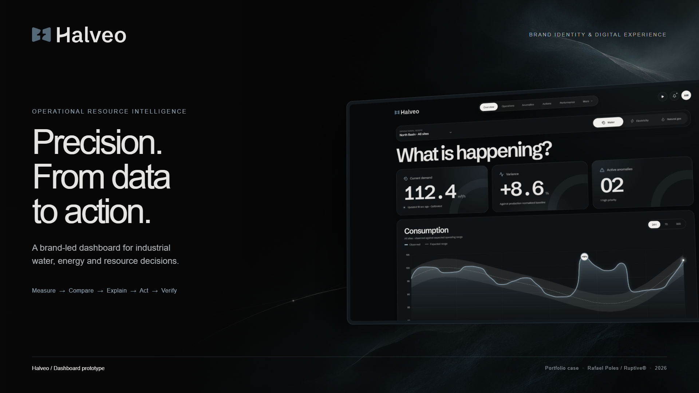
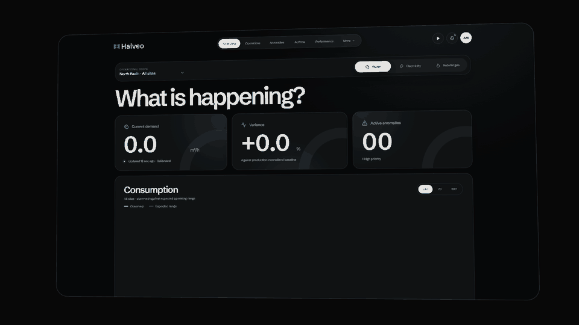

# Halveo Dashboard

**Da medição à ação: inteligência operacional para recursos industriais.**

Case fictício de **Rafael Poles / Ruptive®**, que conecta estratégia de marca, identidade visual, produto digital, visualização de dados e motion. O dashboard apresenta consumo de água, eletricidade e gás natural em uma experiência orientada à investigação de desperdícios e ao acompanhamento de ações.

[English / README principal](README.md) · [Guia de produto](docs/product.md) · [Galeria e demonstração](docs/demo.md)

## O projeto

A Halveo representa a evolução da EcoSense: de consultoria ambiental periódica para uma plataforma recorrente de inteligência operacional. A interface traduz essa mudança em **medir → comparar → explicar → agir → verificar**.

O princípio central é mostrar o dado antes da interpretação. Fatos observados, hipóteses, oportunidades estimadas e resultados verificados têm funções distintas. O benefício ambiental decorre da precisão operacional.



[Motion existente em Full HD, 20 segundos e 60 fps](docs/media/dashboard-motion.mp4). É uma apresentação editada a partir de capturas da interface, com efeitos sonoros. As capturas da galeria foram refeitas a partir do build atual.

## Funcionalidades

| Área | O que demonstra |
| --- | --- |
| Overview | Demanda, desvios, anomalias, comparação de períodos, unidades e recursos |
| Operations | Perfil de consumo, busca de ativos, qualidade e metodologia de comparação |
| Anomalies | Filtros de severidade e painel de investigação com fato, hipótese e regra de verificação |
| Actions | Criação de ação, progressão de status e persistência no navegador |
| Performance | Economia ilustrativa, tendência anual e separação entre estimativas e resultados |
| Reports | Limites do relatório, referências ilustrativas, eventos de auditoria e CSV |
| Data Sources | Fontes de exemplo, cobertura, frequência e qualidade do dado |
| Settings | Densidade compacta, demonstração guiada e preferência de movimento |

A interface usa inglês canadense, moeda e unidades coerentes com o cenário fictício de três instalações da North Basin Manufacturing.

## Identidade e implementação

O símbolo original revela um **raio em espaço negativo**. A paleta combina carbono `#0A0A0A`, azul ardósia `#536977` e branco mineral `#E5E4E2`. A tipografia do app é Schibsted Grotesk.

O front-end utiliza React, TypeScript, Vite, ECharts, Motion, GSAP, Anime.js, Three.js e Lucide. Playwright valida os principais fluxos e permite repetir as capturas.

## Executar

Requisitos: Node.js 24 e pnpm 11.25.0. Não são necessárias chaves, contas ou variáveis de ambiente.

```sh
pnpm install --frozen-lockfile
pnpm dev
```

```sh
pnpm build
pnpm preview
```

Para testes e capturas: `pnpm exec playwright install chromium`, seguido de `pnpm test:smoke` ou `pnpm capture`, após gerar o build. Instruções completas em [development.md](docs/development.md).

## Limites da demonstração

O projeto é um protótipo de portfólio. Empresas, pessoas, dados, economias e auditorias são fictícios. Não há backend, autenticação, sensores ou integrações reais. A verificação de ações é simulada e não recalcula os totais fixos de Performance. O CSV exporta duas linhas de exemplo. Os filtros de unidade e recurso se aplicam a Overview e Operations.

## Documentação

| Documento | Conteúdo |
| --- | --- |
| [Produto](docs/product.md) | Contexto, públicos, módulos e escopo atual |
| [Arquitetura](docs/architecture.md) | Organização do código, estados e fluxo de dados |
| [Design system](docs/design-system.md) | Identidade, componentes, movimento e responsividade |
| [Desenvolvimento](docs/development.md) | Instalação, comandos, validação e hospedagem estática |
| [Demonstração](docs/demo.md) | Capturas das oito áreas, roteiro e mídia |
| [Entrega](docs/delivery.md) | Organização, verificações e limitações da validação |
| [Contexto recuperado](docs/project-context.pt-BR.md) | Síntese do projeto maior de branding e decisões preservadas |

Autoria: **Rafael Poles / Ruptive®**. Desenvolvimento com assistência de IA; fundo abstrato da capa gerado por IA, combinado ao SVG original e à captura real do app. [Créditos](docs/credits.md) · [Direitos](LICENSE).
