# Demo and screenshot gallery

## Suggested walkthrough

| Step | View | What to inspect |
| --- | --- | --- |
| 1 — Measure / compare | Overview | Demand versus expected range; site, resource and period selection |
| 2 — Locate | Operations | Resource profile, asset search and baseline explanation |
| 3 — Explain | Anomalies | Severity, evidence, confidence, hypothesis and verification rule |
| 4 — Act | Actions | Linked action or a new investigation, then status progression |
| 5 — Verify | Performance | Separate categories for estimated, implemented and verified value |
| 6 — Report | More → Reports | Reporting boundary, illustrative mappings and sample CSV |
| 7 — Trust / configure | More → Data Sources / Settings | Data quality, compact density and guided demo |

Anomaly AN-1048 already has a linked action. The Low-severity Paint Booth 01 anomaly has no initial action, making it a useful example of new-action creation. Reloading returns to Overview while preserving saved actions and preferences.

## Existing portfolio motion

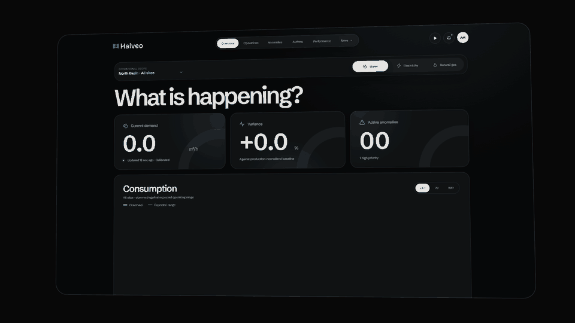

[Full HD MP4 with sound](media/dashboard-motion.mp4)

| File | Format | Source |
| --- | --- | --- |
| `dashboard-motion.gif` | 960 × 540; 15 fps; 20 seconds; looping; 64-colour palette | Existing compact portfolio export |
| `dashboard-motion.mp4` | 1920 × 1080; 60 fps; 20 seconds | Existing edited dashboard presentation with interface captures and SFX |

The animation is an edited presentation, not an uncut browser recording. It illustrates the prior dashboard interaction sequence and was reused to preserve the approved motion direction. Fresh screenshots below represent the current production build. Audio attribution is in [credits](credits.md).

## Current production-build screenshots

Desktop captures use a 1920 × 1080 viewport and a fresh browser context with reduced motion. Font appearance follows available network/font loading; the app includes a system fallback. Capture details are recorded in [captures.json](media/captures.json).

### Overview

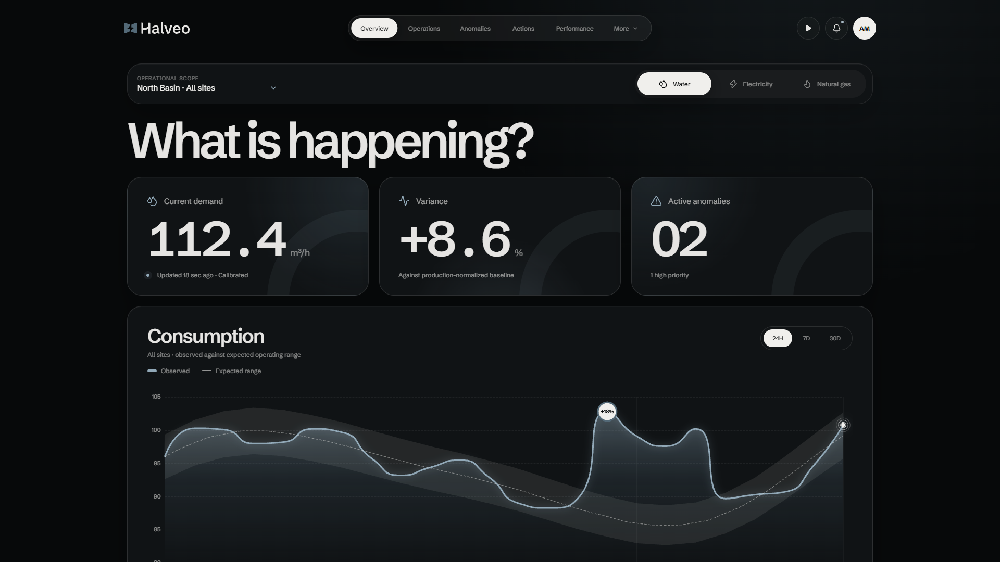

[Full-page overview](media/overview-full.png)

### Operations

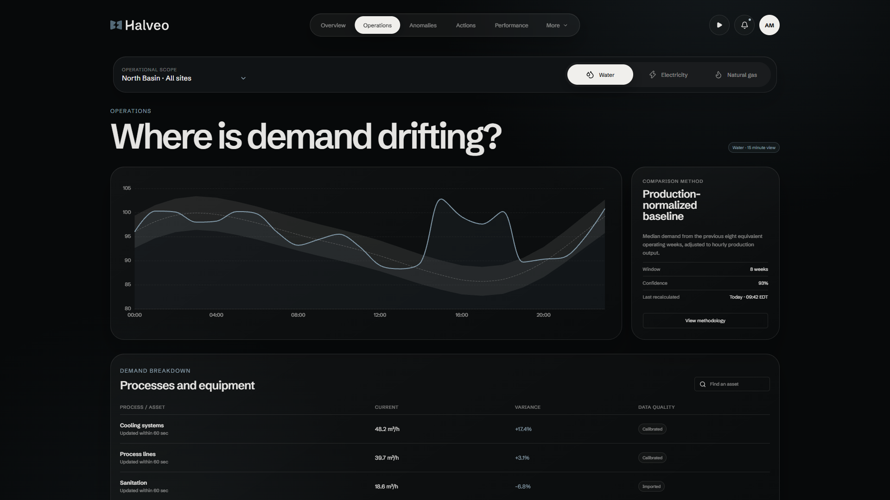

### Anomalies

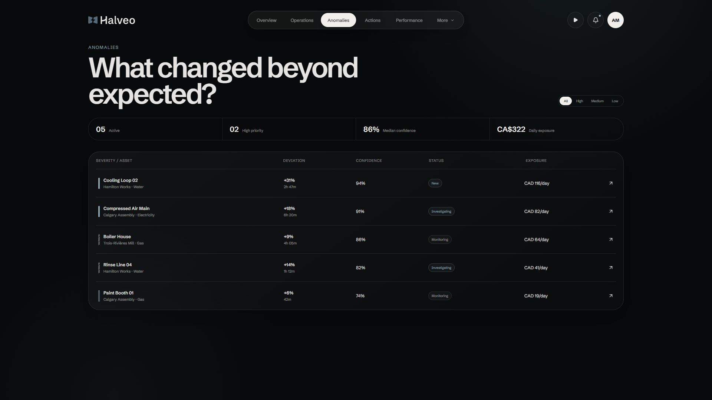

### Investigation detail

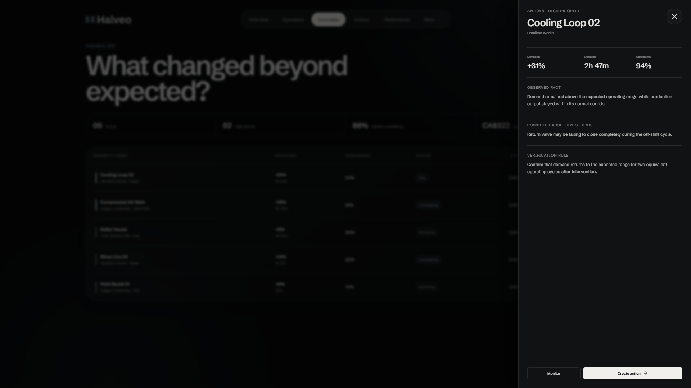

### Actions

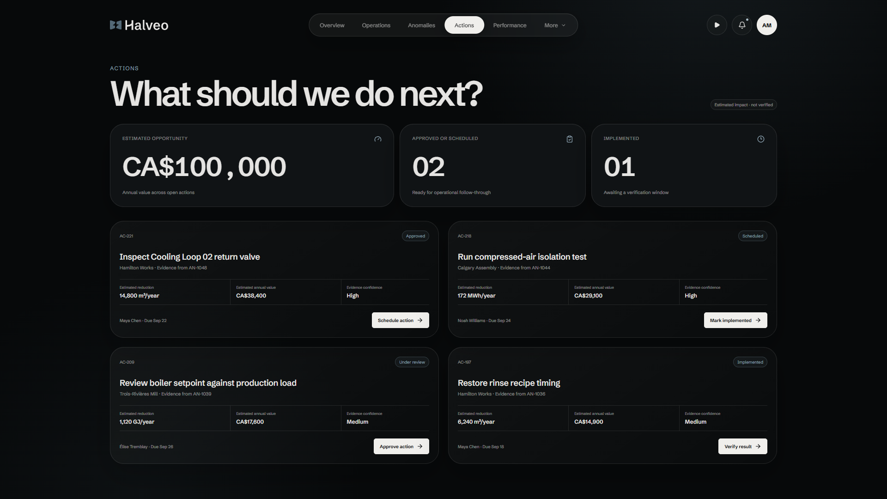

### Performance

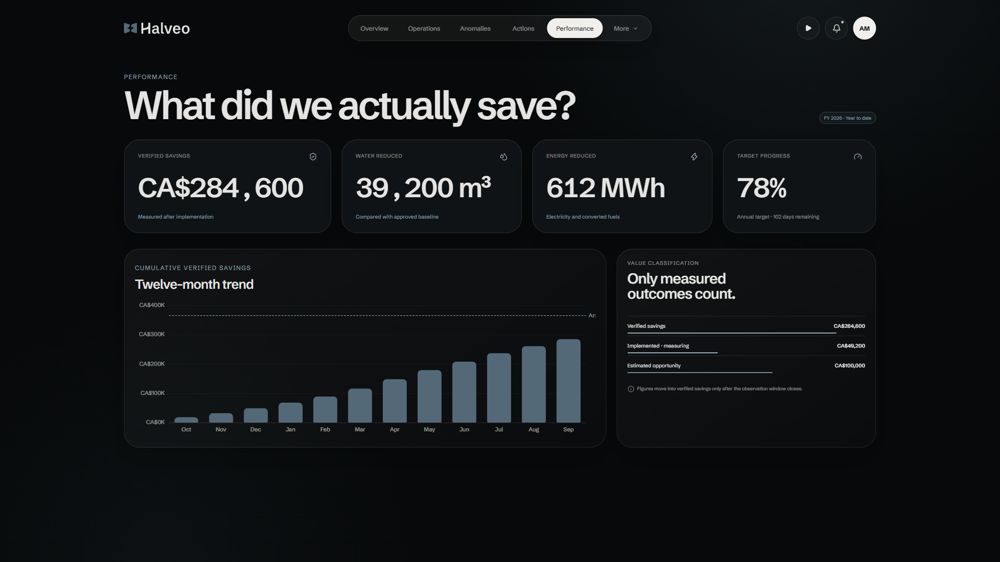

### Reports

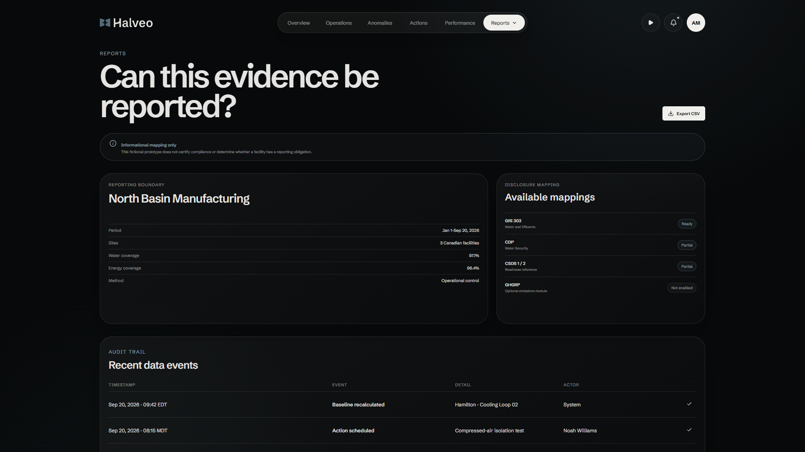

### Data Sources

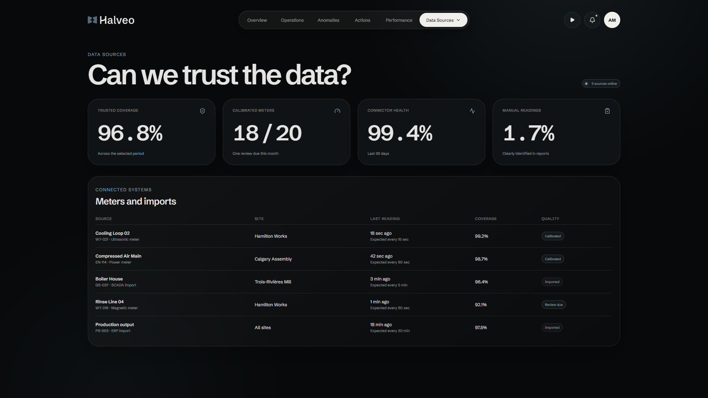

### Settings

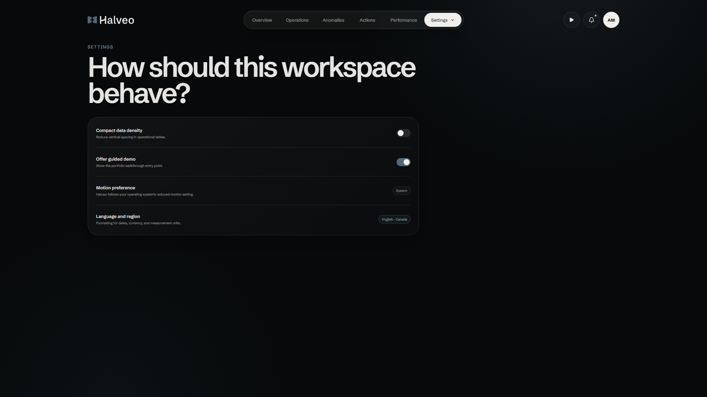

### Mobile

Full-page capture at a 390 × 844 viewport:

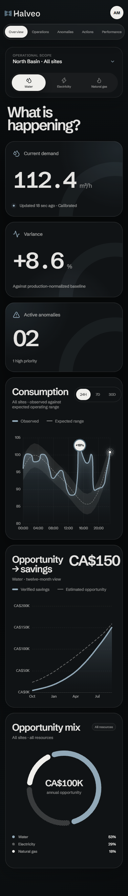

## Cover assets

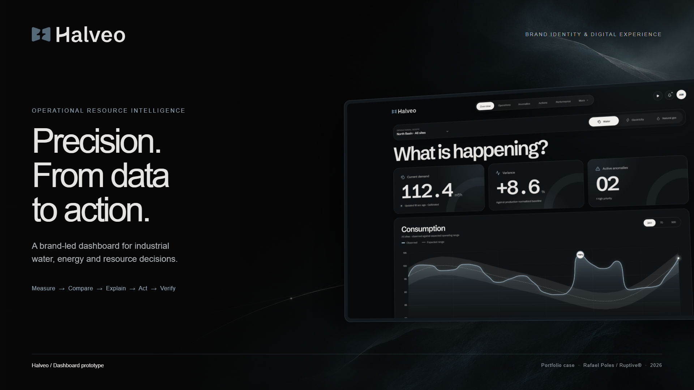

[1280 × 640 social preview](media/social-preview.png). The cover is a composed portfolio graphic, not a screenshot of an additional application screen.
